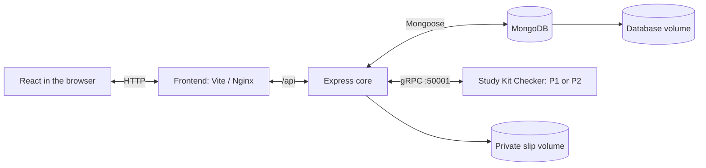

# Simple Shop

A stationery storefront with account-based shopping, persistent carts, bank-transfer slip submission, and an optional Study Kit Checker. Built with React, Express, and MongoDB, with a separate gRPC plug-in service and Docker Compose workflows for development and deployment.

## Features

- Register, sign in, and browse a responsive stationery catalog.
- Filter products by category and manage a cart saved to your account.
- Submit a PNG/JPEG payment slip and track an order's review status.
- Review orders through an operator CLI with recorded decisions and timestamps.
- Check a cart against exam preparation, journaling, or desk organization requirements.
- Switch between two plug-in algorithms without changing the core application.
- Keep shopping and checking out when the optional plug-in is stopped or disabled.
- Run from source locally or deploy published images to a Linux host.

Payment slips are reviewed manually. Uploading a slip does not verify a bank transfer. Sample-payment mode is enabled by default and requires no real transfer.

## Architecture



The core owns accounts, sessions, products, carts, orders, and upload storage. The plug-in owns kit rules and communicates through one shared Protocol Buffers contract. It receives catalog/cart data without customer identity, prices, or database credentials. The core resolves suggested IDs against its current catalog before returning products to the browser.

In a deployed image, Nginx serves the built React app and proxies `/api` to Express. The database, backend, and plug-in remain on the internal Compose network; the frontend is the web entry point.

## Stack

| Area | Technologies |
| --- | --- |
| Frontend | React, React Router, Vite, Lucide icons, CSS |
| API | Node.js 24, Express 5, Zod, Mongoose |
| Authentication | Argon2id, server-side sessions, MongoDB session storage, CSRF protection |
| Upload processing | Multer, Sharp, private filesystem storage |
| Extension | `@grpc/grpc-js`, `@grpc/proto-loader`, Protocol Buffers |
| Runtime | Docker Compose, MongoDB 7.0.43, Nginx |
| Checks | ESLint, Prettier, Node test runner, Supertest, Playwright |

Dependency versions are locked in each package's `package-lock.json`.

## Start locally

Requirements: Docker Engine/Docker Desktop with Compose. Host Node.js 24 is useful for tooling but is not required to run the containers.

From the repository root:

```bash
sh scripts/setup-env.sh
sh scripts/shop.sh dev up --build -d --wait
```

Open **http://localhost:8080** and create an account. The setup script generates local secrets and preserves an existing `.env`.

`dev` runs Vite and Node watch processes with source mounts. For a local run using the built Nginx frontend and deployment-style backend/plug-in images:

```bash
sh scripts/shop.sh local up --build -d --wait
```

Choose one local mode at a time. Both use the same local database/upload volumes and web port.

Useful commands:

```bash
sh scripts/shop.sh dev ps
sh scripts/shop.sh dev logs --tail=50 backend study-kit-plugin
sh scripts/shop.sh dev stop
```

The helper simply selects Compose files; it passes the remaining arguments to `docker compose`. `-d` runs in the background and `--wait` checks readiness. Named volumes preserve data across normal container recreation.

## Shopping and payment review

1. Create an account and add items to your bag.
2. Optionally use the Study Kit Checker.
3. Continue to checkout and upload a PNG/JPEG slip, up to 5 MiB and 20 megapixels.
4. In sample-payment mode, the checkout page provides a clearly marked test slip.
5. Submit the order and view its reference and status in My orders.

An operator with local Docker access can review pending payments:

```bash
sh scripts/orders.sh --mode local list
sh scripts/orders.sh --mode local inspect ORDER_REFERENCE
sh scripts/orders.sh --mode local review ORDER_REFERENCE CONFIRMED --reviewer "Operator"
sh scripts/orders.sh --mode local review ORDER_REFERENCE REJECTED --reviewer "Operator" --reason "Transfer details need checking."
```

Replace `ORDER_REFERENCE` with a real reference from `list` and choose one review decision. `inspect` exports the private slip to a temporary directory and prints its location. Use `--mode vm` when running the same helper inside the deployment host. There is no public administrator website.

## Optional Study Kit Checker

| Purpose | Essentials |
| --- | --- |
| Exam preparation | Notebook/notepad; writing item |
| Journaling | Notebook; writing item; decoration |
| Desk organization | Writing item; tray/pouch |

| Algorithm tag | Behaviour |
| --- | --- |
| `P1` | Checks whether at least one suitable product covers each essential |
| `P2` | Counts catalog units and requires two writing items, including a spare |

For Exam preparation, notebook ×1 + pen ×1 is ready under P1. The same cart is incomplete under P2 until another writing item is added. A Pencil trio is one purchasable catalog unit.

The UI displays the running algorithm, checks real gRPC availability, and hides stale results after cart or algorithm changes. Rules live in `plugins/study-kit/src/rules.js`; the canonical contract is `backend/src/plugins/studyKit.proto`.

To observe optional-service behaviour:

```bash
sh scripts/shop.sh dev stop study-kit-plugin
sh scripts/shop.sh dev start study-kit-plugin
```

Wait for the next availability check or use the panel's refresh button. Checkout remains independent. To start only the core services, use `up --build -d --wait mongodb backend frontend`. To disable the adapter entirely, set `STUDY_KIT_ENABLED=false` in the environment file and recreate the backend.

## Deployment with published images

The standalone `compose.deploy.yaml` uses images instead of source builds. `scripts/publish-images.sh` publishes:

- `shinebo/ecommerce-frontend:APP_IMAGE_TAG`
- `shinebo/ecommerce-backend:APP_IMAGE_TAG`
- `shinebo/ecommerce-study-kit:P1` and `:P2`

The account can be changed with `DOCKERHUB_USERNAME`. Publishing defaults to `linux/arm64`; use `PLATFORMS=linux/amd64,linux/arm64` for both architectures.

Create the three registry repositories and a Buildx builder before publishing:

```bash
docker buildx create --name ecommerce-builder --driver docker-container --bootstrap
APP_IMAGE_TAG=v2 sh scripts/publish-images.sh
```

Create the builder once. Use a new application tag for later releases. The script bakes each algorithm into a separate plug-in image; assigning two names to the same image would not change the algorithm.

On the deployment host, retain this layout:

```text
ecommerce/
├── compose.deploy.yaml
├── .env.vm.example
├── .env.vm                   # generated privately on the host
├── scripts/
│   ├── setup-vm-env.sh
│   ├── shop.sh
│   └── orders.sh
└── docker/mongo-init/01-create-app-user.js
```

Generate fresh configuration using the exact browser origin, then select the published application tag in `.env.vm`:

```bash
sh scripts/setup-vm-env.sh http://your-host:8080
# Edit APP_IMAGE_TAG, APP_PORT, and other deployment settings as needed.
sh scripts/shop.sh vm pull
sh scripts/shop.sh vm up -d --wait
```

For the VirtualBox NAT setup, the example browser origin is `http://localhost:8088`, forwarding to port 80 inside the VM. Local and VM copies have independent databases, upload volumes, and default session-cookie names. They do not synchronize records.

To switch algorithms, change the default `P1`/`P2` in the plug-in image line in `compose.deploy.yaml`, or explicitly set `PLUGIN_TAG` in `.env.vm`, then run:

```bash
sh scripts/shop.sh vm pull study-kit-plugin
sh scripts/shop.sh vm up -d --no-deps --wait study-kit-plugin
```

An explicit environment value takes precedence over the Compose default. Recreating the plug-in preserves orders, accounts, carts, and uploads.

## Configuration and persistence

`.env.example` and `.env.vm.example` describe shareable settings. Generated environment files, uploads, database exports, and local learning material are excluded from Git.

| Setting | Purpose |
| --- | --- |
| `APP_PORT`, `APP_ORIGIN` | Published web port and exact browser origin |
| `SESSION_SECRET`, `SESSION_COOKIE_NAME` | Session signing secret and environment-specific cookie name |
| `MONGO_*` | Database image, name, and credentials |
| `PAYMENT_DEMO_MODE`, `BANK_*` | Sample-payment mode or receiving-bank display details |
| `SEED_DEMO_DATA`, `DEMO_CUSTOMER_PASSWORD` | Optional catalog/demo account seeding |
| `STUDY_KIT_ENABLED`, `PLUGIN_*` | Optional adapter, gRPC address, timeout, deployment tag |

The app saves users, products, carts, orders, and sessions in MongoDB. Slip bytes live in `slip_uploads`; orders hold their metadata/reference. Order snapshots preserve purchased prices. Session expiry does not delete customer records.

Normal startup inserts missing seed records without overwriting existing products. To intentionally apply `backend/src/data/products.json` changes:

```bash
sh scripts/shop.sh dev exec backend npm run catalog:update
```

Named volumes are persistent storage, not automatic backups. Back up MongoDB, slip files, and private configuration together. `down -v` deletes the project's volumes; it is not a routine shutdown command. Do not change database passwords against an initialized volume without updating the database users.

## Development checks

For host tooling, install Node.js 24 and each package's locked dependencies:

```bash
npm ci
npm --prefix backend ci
npm --prefix frontend ci
npm --prefix plugins/study-kit ci
npm run format:check
npm run lint
npm run test:scripts
npm run test:plugin
npm test
```

API tests use a separate Compose project and a database ending in `_test`. Production backend/plug-in image stages omit development dependencies and test files; development/test stages keep the required tools.

With the P1 shop running, install Playwright Chromium and run browser journeys:

```bash
cd frontend
npx playwright install chromium --only-shell
npm run test:e2e
```

Browser journeys create synthetic customer/order records in their target shop. The stop/start lifecycle test requires explicit `RUN_PLUGIN_LIFECYCLE_TEST=true`; it restores the plug-in afterward. Use an intended test instance when running journeys that create records or control containers.

## Repository layout

```text
backend/             Express routes, services, models, operator CLI, API tests
frontend/            React pages, shared state, UI assets, Vite/Nginx configuration
plugins/study-kit/   Independent gRPC service, algorithms, health check, tests
backend/src/plugins/ Shared .proto, core gRPC adapter, extension HTTP boundary
docker/mongo-init/   Database-user initialization for a new volume
scripts/             Setup, Compose selection, publishing, operator utilities
tests/               Shell-helper tests and browser journeys
compose*.yaml        Local, development, Compass, isolated test, and image deployment modes
```

## Operational scope

The application includes authenticated access, request validation, CSRF checks, private slip access, versioned cart updates, and duplicate-checkout protection. It currently uses manual payment review and a local operator CLI. Automated bank verification, finite inventory, shipping fulfilment, refunds, password recovery, and an administrator UI are not implemented.

The supplied HTTP configuration suits local/private-host demonstrations. Internet-facing operation requires HTTPS, appropriate cookie/origin settings, monitored backups, and deployment-specific access controls. There is no automatic schema migration, production monitoring service, or database backup scheduler included.
